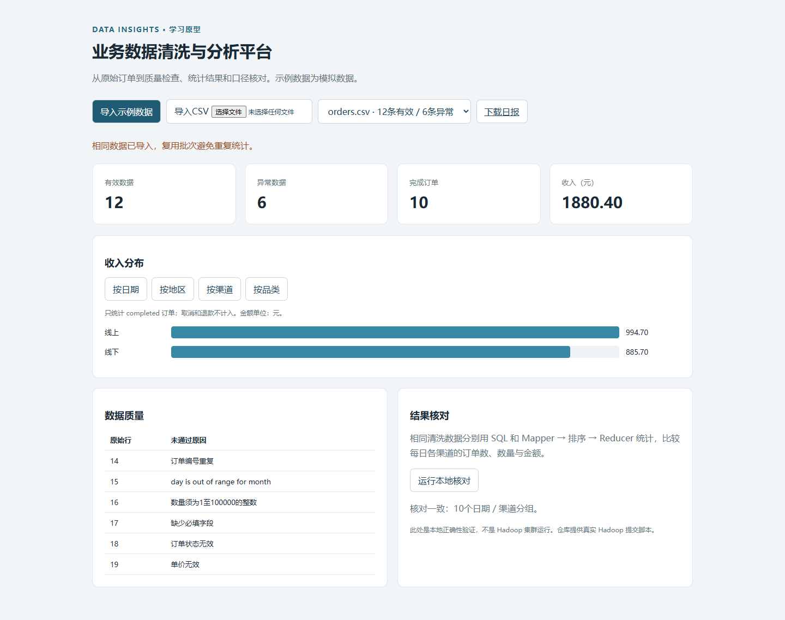

# 业务数据清洗与分析平台

一个从CSV到质量检查、SQL统计和结果核对的小型学习项目。用订单数据练习数据处理流程；附带可提交给Hadoop Streaming的Python Mapper/Reducer。开发使用AI辅助，样例全部是模拟数据。



## 功能

- CSV批次导入：检查必填字段、日期、数量、金额、订单状态和批次内重复编号；异常数据隔离，页面显示原因。
- 相同CSV用内容哈希识别批次，重复导入不重复计数。不同CSV之间不去重，统计范围是单个批次。
- 金额以整数分保存，避免浮点误差；只统计completed订单，不把取消／退款纳入收入。
- SQL按日期、地区、渠道和品类聚合，网页展示指标与条形图，可以下载日报。
- 同一清洗输入用SQL和Mapper→排序→Reducer分别统计，核对每日渠道的订单数、数量和金额。

## 运行

Python 3.12+，不依赖Node、外部数据库或付费API。

```powershell
python -m venv .venv
.\.venv\Scripts\python.exe -m pip install -e ".[dev]"
.\.venv\Scripts\python.exe scripts/demo.py
.\.venv\Scripts\python.exe -m uvicorn datahub.main:app --host 127.0.0.1 --port 8002
```

打开 http://127.0.0.1:8002 ，点击导入示例数据，再切换统计维度和运行核对。API文档在 `/docs`。CSV格式见 `samples/orders.csv`，示例含12条有效记录和6条刻意设置的异常。

## Hadoop部分

`jobs/mapper.py`和`jobs/reducer.py`按标准输入／输出通信。`scripts/run_hadoop.sh`在已有Linux Hadoop环境上完成HDFS上传、Streaming作业提交和结果下载，要求每个Worker有Python3。

```bash
python3 scripts/demo.py
bash scripts/run_hadoop.sh data/normalized.jsonl
```

**验证边界：当前电脑没有Docker/WSL Linux/Hadoop集群。本项目已验证本地Mapper/Reducer与SQL结果一致；没有声称已完成HDFS/YARN集群运行、性能压测或海量数据处理。提交脚本须在真实Hadoop环境另行验收。** 本地核对函数会把数据装入内存，不能当作分布式执行。

## 测试

```powershell
.\.venv\Scripts\python.exe -m pytest -q
```

测试覆盖异常隔离、精确金额、批次幂等、统计口径、SQL与Streaming一致性、API和导出。未实现鉴权或生产级任务队列，仅绑定本机使用。

真实Hadoop作业生成结果后，可用 `python3 scripts/compare_hadoop.py data/结果文件.tsv` 与SQL进行核对。目前仅提供该验收入口，未在本机执行真实Hadoop。

技术参考：[Apache Hadoop Streaming官方文档](https://hadoop.apache.org/docs/stable/hadoop-streaming/HadoopStreaming.html)。
